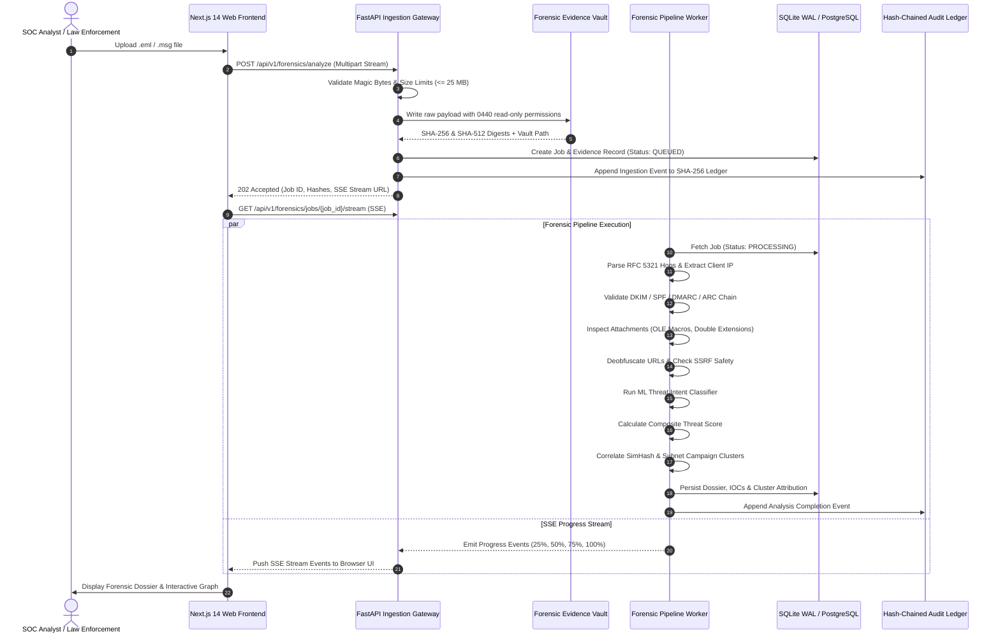

# System Architecture & Technical Specifications

**Platform:** AI-Powered Email Threat Detection, GeoLocation and Forensic Intelligence Platform  
**Authority:** AICTE Cyber Security Cell | Smart India Hackathon (Problem Statement ID: 26106)  
**Standard:** Section 63 of Bharatiya Sakshya Adhiniyam (BSA), 2023

---

## 1. High-Level Architecture Overview

The platform is designed as an enterprise-grade forensic intelligence solution for high-throughput cyber threat analysis. It decouples high-speed synchronous HTTP ingestion from deep forensic extraction and machine learning inference using an asynchronous job pipeline.

```
                    ┌─────────────────────────────────────────┐
                    │            Next.js 14 SOC UI            │
                    │   (Bento Grid, Cytoscape, Real-time SSE) │
                    └────────────────────┬────────────────────┘
                                         │ HTTPS / SSE
                                         ▼
                    ┌─────────────────────────────────────────┐
                    │             FastAPI Backend             │
                    │   (Security Headers, Argon2, Rate-Limit)│
                    └────┬───────────────────────────────┬────┘
                         │                               │
        ┌────────────────▼───────────────┐               │
        │ Cryptographic Evidence Vault   │               │
        │ - Dual Hashing (SHA256/SHA512) │               │
        │ - Physical File Locking        │               │
        │ - Export-Time Tamper Guard     │               │
        └────────────────────────────────┘               │
                         ┌───────────────────────────────▼────┐
                         │   Asynchronous Pipeline Workers    │
                         │ - RFC 5321 Hop Parser & MaxMind    │
                         │ - DKIM, SPF, DMARC, ARC Validation │
                         │ - Attachment & OLE Macro Analyzer  │
                         │ - URL Deobfuscation & SSRF Filter  │
                         │ - TF-IDF + LogisticRegression AI   │
                         │ - Dynamic Multi-Signal Clustering  │
                         └───────────────┬────────────────────┘
                                         │
                    ┌────────────────────▼────────────────────┐
                    │      Storage & Persistence Layer        │
                    │ - SQLite (WAL Mode) / PostgreSQL        │
                    │ - SHA-256 Hash-Chained Audit Ledger     │
                    │ - Section 63 BSA PDF Reporting Engine   │
                    └─────────────────────────────────────────┘
```

---

## 2. Ingestion & Analysis Lifecycle



---

## 3. Core Forensic Subsystems

### A. Cryptographic Evidence Vault (`backend/app/database/vault.py`)
- **Dual Cryptographic Hashing:** Computes SHA-256 (64 hex characters) and SHA-512 (128 hex characters) simultaneously in 64 KB memory chunks.
- **Physical Isolation:** Stored in read-only (`0o440`) files named after their SHA-256 digest (`storage/vault/<sha256>.raw`).
- **Integrity Sweeper:** Background sweep (`POST /api/v1/forensics/vault/sweep`) iterates through all stored files, re-computes hashes from physical disk, and flags any bit rot or tampering.

### B. Protocol Authentication Engine (`backend/app/forensics/auth_validator.py`)
- **DKIM:** Multi-signature parsing, key rotation resilience, and canonicalization support via `dkimpy`.
- **SPF:** Resolves trusted inbound MTA boundary IP and executes RFC 7208 evaluation via `pyspf`.
- **DMARC:** Public Suffix List (PSL) organizational domain alignment (`strict` vs `relaxed` mode).
- **ARC (Authenticated Received Chain):** Validates ARC-Seal, ARC-Message-Signature, and ARC-Authentication-Results across multi-hop forwarding routes.

### C. Reverse Hop Parser & GeoIP Engine (`backend/app/forensics/hop_traversal.py`)
- **Multi-Vendor Syntax Support:** Postfix, Microsoft Exchange, Google Workspace, Sendmail, Exim, and qmail.
- **Clock Skew Anomaly Detection:** Flags transmission timestamp anomalies exceeding +/- 300 seconds.
- **Zero-Guess GeoIP Policy:** Uses MaxMind GeoLite2 City / ASN. Resolves accurate latitude/longitude, accuracy radius in km, and database build date. Never guesses or synthesizes coordinates for unresolvable IPs.

### D. Machine Learning Threat Classifier (`backend/app/ai/nlp_engine.py`)
- **Architecture:** Scikit-learn Pipeline with `TfidfVectorizer(ngram=(1,2), sublinear_tf=True)` and `LogisticRegression(C=2.0, class_weight='balanced')`.
- **Threat Taxonomy:** 4 classes (`BEC_FINANCIAL`, `PHISHING`, `EXTORTION_COERCION`, `BENIGN`).
- **Explainable AI:** Computes per-token linear feature weight attributions to visually highlight malicious intent in the UI.
- **Calibration & Uncertain State:** Flags predictions with low posterior probability or boundary scores as `UNCERTAIN` to prevent false positive alert fatigue.

### E. Dynamic Campaign Correlation Engine (`backend/app/forensics/campaign_clusterer.py`)
- **Multi-Signal Correlation:** Combines SimHash 64-bit lexical similarity (Hamming distance <= 3), shared non-fanout infrastructure subnets (`/24`), threat actor domains, and targeted entities.
- **Interactive Analyst Workflows:** Supports runtime campaign labeling, splitting, and merging with immutable audit ledger tracking.
- **Standards Compliance:** Exports full threat intelligence graphs as valid OASIS STIX 2.1 JSON Bundles.

---

## 4. Court-Admissible Reporting Engine (`backend/app/reporting/pdf_generator.py`)

Engineered strictly in compliance with **Section 63 of the Bharatiya Sakshya Adhiniyam, 2023**:

1. **Statutory Partition:**
   - **Part A (Automated Technical Parameters):** Hash digests, file byte counts, operating system specs, NTP-synchronized timestamps, and extraction audit trail. Automated tool legitimately self-certifies Part A.
   - **Part B (Lawful Custody Attestation):** Requires signature of the human officer in lawful custody of the computer device. Automated tool marks unknown fields as `[NEEDS LEGAL REVIEW]` and never fabricates human declarations.
2. **Export-Time Vault Verification:** Before generating the PDF, the engine re-reads the raw evidence file directly from physical disk, computes its SHA-256 and SHA-512 digests, and verifies them against database records. If any discrepancy exists, the export halts immediately with `409 Conflict`.
3. **Offline Independent Verification:** Third-party forensic examiners can verify any exported PDF and `.raw` file offline using `scripts/verify_report.py`.
